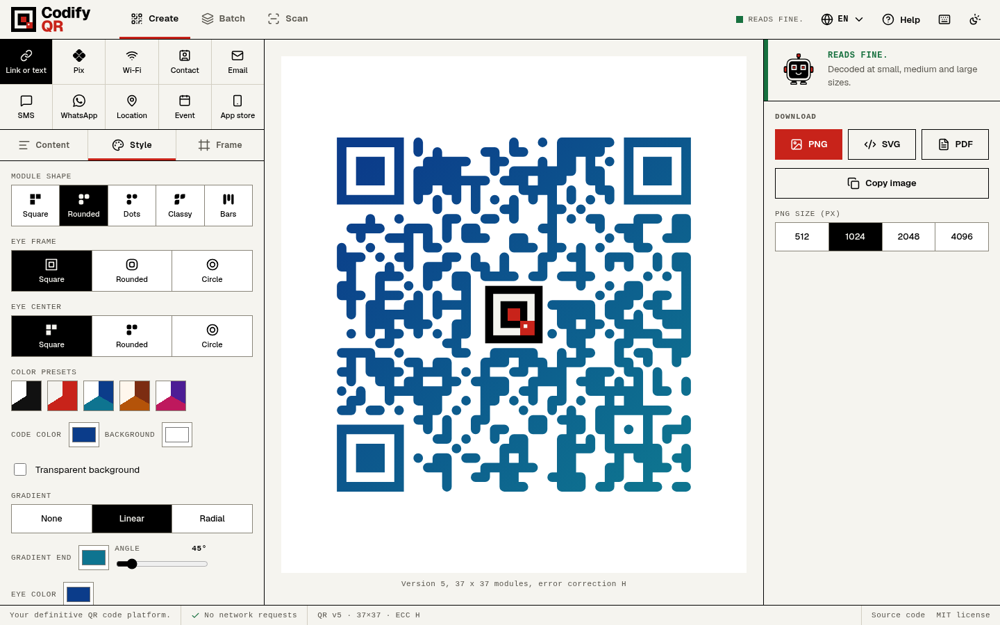
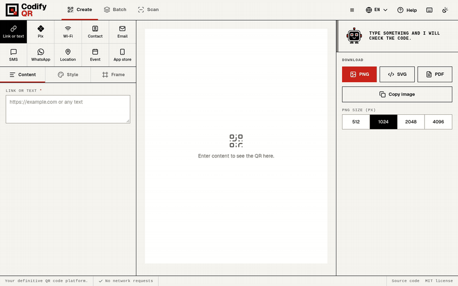
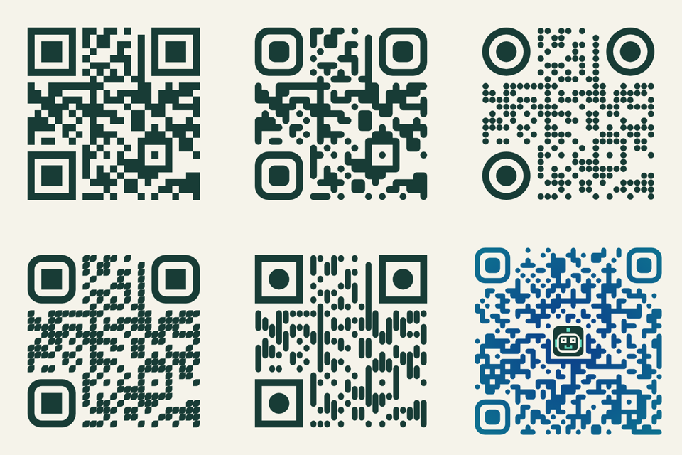
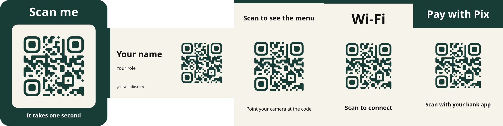
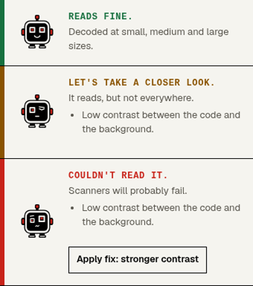
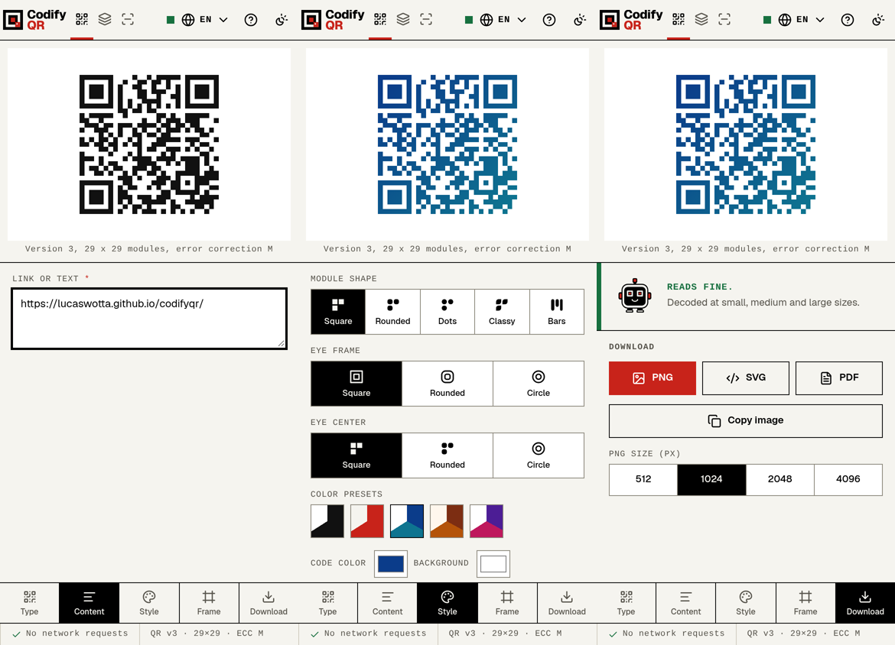
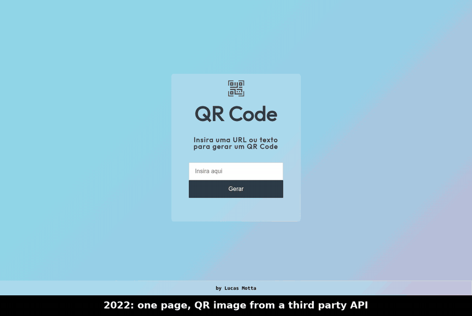

<div align="center">

<picture>
  <source media="(prefers-color-scheme: dark)" srcset="docs/media/wordmark-dark.svg">
  
</picture>

<br>
<br>

**A free, open source QR code generator that runs entirely in your browser.**

No account. No tracking. No network request after the page loads.

<br>

<a href="https://github.com/lucaswotta/codifyqr/stargazers"></a>
<a href="https://github.com/lucaswotta/codifyqr/actions/workflows/ci.yml"></a>
<a href="https://github.com/lucaswotta/codifyqr/commits/main"></a>
<a href="https://github.com/lucaswotta/codifyqr/issues"></a>
<a href="LICENSE"></a>
<a href="CONTRIBUTING.md"></a>


<br>

[**Open the app**](https://lucaswotta.github.io/codifyqr/) ·
[Features](#features) ·
[Run it yourself](#run-it-yourself) ·
[FAQ](#faq) ·
[Contribute](CONTRIBUTING.md) ·
[Português](README.pt-BR.md) ·
[Español](README.es.md)

<br>

<picture>
  <source media="(prefers-color-scheme: dark)" srcset="docs/media/hero-dark.png">
  
</picture>

</div>

## Why CodifyQR

- **It tells you whether the code reads.** Before you download, the app decodes your finished code the way a phone camera would (small, blurred, far away) and says why it fails when it does: low contrast, inverted colors, a logo that is too large, a thin border. It offers a one-click fix.
- **Nothing leaves your device.** The page sends no request after it loads, and the content security policy (`connect-src 'none'`) makes that enforceable, not a promise. Pix keys, Wi-Fi passwords and contact data stay in your tab.
- **The code never expires.** Every code is static: the content is inside the image. There is no redirect service, no subscription and no dashboard to lose access to.
- **It is made for print.** Output is vector SVG, PNG up to 4096 px, and a PDF with the real size in centimeters and a warning when the modules would be too small to print.
- **It speaks Pix.** A static BR Code with the CRC16 checksum, with the key validated (CPF, CNPJ including the alphanumeric format, phone, email, random key) before the code is drawn.

<div align="center">



</div>

## Features

| Area | What you get |
| --- | --- |
| **Content** | Link or text, Pix, Wi-Fi, contact (vCard), email, SMS, WhatsApp, location, calendar event, app store link. |
| **Style** | Five module shapes, three eye frames, three eye centers, gradients, transparent background, adjustable border, colors with presets. |
| **Logo** | Upload PNG, JPG, WebP or SVG. The modules under the logo are removed instead of covered, and the size is limited to what the error correction can recover. |
| **Frames** | Sticker, business card, table card, Wi-Fi sign and Pix charge, with editable text. |
| **Read check** | Three simulated camera qualities, cause of failure, one-click fix. |
| **Export** | PNG (512 to 4096 px), SVG, PDF with physical size, copy to clipboard, share. |
| **Batch** | Paste lines or import a CSV (content and optional file name), up to 500 rows, downloaded as a ZIP. |
| **Reader** | Camera or image. Never opens a link by itself and warns about shorteners, look-alike domains, raw IP addresses, `http`, embedded credentials and `javascript:` or `data:` content. |
| **Saved styles** | Save looks in the browser, export them as a file, or share a link (`#s=...`). Only the look is stored, never the content. |
| **Help and shortcuts** | A built-in guide, and keyboard shortcuts for types, panels, exports, theme and language. Single-key shortcuts can be switched off. |
| **App** | Installable PWA that works offline, light and dark themes, English, Portuguese (Brazil) and Spanish, accessible (WCAG 2.2 AA, checked in CI). |

<div align="center">





</div>

### The read check

<div align="center">



</div>

The check renders the code at 3, 5 and 10 pixels per module, softens it with a blur like a mediocre camera, and decodes it with the platform `BarcodeDetector` when the browser has one and with [jsQR](https://github.com/cozmo/jsQR) otherwise. When a styled code fails at one size, it also retries with blurred and halved copies, because camera apps do the same.

It is a simulation. It catches the common causes of unreadable codes; it does not prove that every phone will read yours, so test one print before you order a thousand.

### On a phone

On narrow screens the preview stays pinned on top and a bottom bar switches between type, content, style, frame and download. The page never scrolls: each panel scrolls inside.

<div align="center">



</div>

## Run it yourself

The app is a static site. Use it online, run it locally, or copy the build to any static host.

**Requirements:** Node 22 or newer and pnpm 12 (`corepack enable`). Google Chrome is needed only for the end to end tests.

```sh
git clone https://github.com/lucaswotta/codifyqr.git
cd codifyqr
pnpm install
pnpm dev          # http://localhost:5173/codifyqr/
```

```sh
pnpm build        # type check, then the site in dist/
pnpm preview      # serve dist/ on http://localhost:4173/codifyqr/
```

**Self-hosting.** Copy `dist/` to any static host (GitHub Pages, Netlify, Cloudflare Pages, an nginx folder). The build uses the base path `/codifyqr/`. Set `CODIFYQR_BASE` to change it, for example `CODIFYQR_BASE=/ pnpm build` to serve from a domain root. If your host can send headers, add the same `Content-Security-Policy` that the page sets in a `<meta>` tag (see `vite.config.ts`), and `frame-ancestors 'none'`.

## Keyboard shortcuts

Press `?` in the app to see them. Single-key shortcuts only work when focus is not in a field, and can be turned off in that dialog.

| Keys | Action |
| --- | --- |
| `1` to `0` | Switch the content type |
| `C` `S` `F` | Open Content, Style or Frame |
| `Ctrl` `K` | Focus the content field |
| `X` | Apply the suggested fix |
| `Ctrl` `Enter` or `P` | Download PNG |
| `V` / `D` / `Y` | Download SVG / open the PDF options / copy the image |
| `[` `]` | Previous or next tool (Create, Batch, Scan) |
| `T` / `L` / `H` | Change theme / language / open help |

## FAQ

**Is it free? What is the catch?**
It is free and MIT licensed. There is no paid tier, no account and no server to pay for.

**Do the codes expire?**
No. They are static: the content is encoded in the image itself. The trade-off is that a printed code cannot be edited later and nothing counts scans.

**Does it track me or upload my data?**
No. The built page makes no network request after it loads. An end to end test fails if one leaves the origin, and the CSP blocks it anyway. Saved styles and style links contain the look only.

**Why does the read check say "risk" for a code that scans on my phone?**
The check is stricter than a good phone. It simulates a small, soft image. Risk means "reads in good conditions, may fail in bad ones". Use the suggested fix, or print larger.

**What size should I print?**
At least 2 cm wide for a short link. The PDF tool shows the size of one module in millimeters and warns below 0.4 mm. More text means smaller modules, so shorten the content or print larger.

**Why is the Pix city optional?**
The BR Code format requires a city field, but banks do not check its value. If you leave it empty, the code carries `BRASIL`.

**Can I make a dynamic Pix charge?**
No. Dynamic charges need a payment service provider. CodifyQR creates static Pix codes.

**Which browsers work?**
The test suite runs in Chrome. The app uses standard web APIs that current Firefox, Edge and Safari (iOS 16 or newer) also have, but those browsers are not covered by CI yet. Reports are welcome.

**Can I self-host it?**
Yes, see [Run it yourself](#run-it-yourself).

## How it works

`src/qr/encoder.ts` builds the module matrix (versions 1 to 40, numeric, alphanumeric and byte modes) and `src/qr/svg.ts` draws it as vector paths. PNG and PDF are rasterized from that vector at the size you pick, so large exports stay sharp. The encoder follows the algorithm of [Project Nayuki's QR Code generator](https://www.nayuki.io/page/qr-code-generator-library) (MIT), rewritten in TypeScript.

Every version (1 to 40) and error correction level is decoded back with jsQR in the unit tests. Version 23 is checked structurally because jsQR lists a wrong alignment pattern position for it. A separate script (`scripts/crosscheck`) exports 48 styled PNGs and reads them with [zxing-cpp](https://github.com/zxing-cpp/zxing-cpp), an independent decoder: 48 of 48 were read.

## Privacy and security

- Content security policy on the built page: `default-src 'none'`, `script-src 'self'`, `connect-src 'none'`.
- No analytics, no cookies, no external fonts, scripts or images. The font (Geist) is bundled.
- Pix keys, Wi-Fi passwords and other content are never stored, put in a URL or written to a log. Exported file names do not contain the content.
- Style data from a link or a file is validated field by field before use. Logo SVGs are embedded as images, so scripts inside them do not run.

Report vulnerabilities privately, see [SECURITY.md](SECURITY.md).

## Quality gates

CI runs on every branch and blocks the deploy when something fails:

- Biome lint and format, TypeScript in strict mode.
- Unit tests (Vitest) and end to end tests (Playwright, Chrome): every content type is exported and decoded back, plus styles, sliders, frames, PDF, batch, a fake camera that films a QR code, offline use, the content security policy, translations and a check that the page never scrolls at any size.
- axe accessibility checks (WCAG 2.2 AA, no serious violations).
- First load budget: 80 KB gzip, font included (`scripts/size-budget.mjs`; currently about 70 KB).
- Lighthouse: performance at least 95, accessibility, best practices and SEO at 100 (`scripts/lighthouse-check.mjs`).

## Limitations

- Codes are always static. There is no redirect service, so a code cannot be edited after printing and nothing counts scans. That is deliberate.
- The PDF embeds a high resolution image (up to 600 dpi, less on large pages). For fully vector print files use the SVG.
- The read check is a simulation and does not prove that every phone will read a code.
- The Pix builder creates static codes only.
- Text is limited to 2000 characters and to what fits in a version 40 code with the chosen error correction.
- The batch tool processes up to 500 rows on the main thread, in small steps ([issue #12](https://github.com/lucaswotta/codifyqr/issues/12)).
- Safari before 16.4 has no `CompressionStream`; PDFs there use a lower resolution without compression.

## Roadmap

Open ideas with acceptance criteria are in the [issues](https://github.com/lucaswotta/codifyqr/issues): vector PDF for plain codes, mixed numeric/alphanumeric/byte segments to shrink codes, a Web Worker for batch, a copyable view of the encoded text, and more languages. Good first issues are labeled.

## Contributing

Pull requests are welcome. [CONTRIBUTING.md](CONTRIBUTING.md) covers setup, the rules, how to add a language (translations are plain JSON files, checked by a test) and where things are in the code. Security reports: [SECURITY.md](SECURITY.md).

```text
src/
  qr/         encoder, styled SVG renderer, frames
  payloads/   Pix, Wi-Fi, contact, email and the other content builders
  verify/     read check, suggested fixes, reader analysis
  export/     PNG, PDF, ZIP, CSV
  app/        interface (editor, batch, reader, dialogs, icons)
  locales/    en.json, pt-BR.json, es.json
scripts/      budgets, media and brand rendering, decoder cross-check
brand/        logo, mascot and palette sources
```

## Project history

| Period | State |
| --- | --- |
| 2022 | One page that called a third party QR image API. |
| 2025-08 | Local generation with `qrcodejs` and PNG download. |
| 2025-09 | Logo, text, colors and three export sizes; stretched bitmap output. |
| 2026-10 | Rewrite: own encoder, vector rendering, read check, ten content types, PWA, new interface. See [CHANGELOG.md](CHANGELOG.md). |



Each phase was recorded from its own commit (`004d276`, `c46d0a5`, `cd6e7c9` and the current build): [2022](docs/media/evolution/2022-10.gif), [2025-08](docs/media/evolution/2025-08.gif), [2025-09](docs/media/evolution/2025-09.gif), [2026-10](docs/media/evolution/2026-10.gif). `scripts/media/evolution.mjs` regenerates them.

## Acknowledgements

[Project Nayuki](https://www.nayuki.io/page/qr-code-generator-library) (QR algorithm), [jsQR](https://github.com/cozmo/jsQR) (decoder), [zxing-cpp](https://github.com/zxing-cpp/zxing-cpp) (cross-check), [Geist](https://github.com/vercel/geist-font) (font), [Lucide](https://lucide.dev) and [Simple Icons](https://simpleicons.org) (icons). Licenses in [NOTICE](NOTICE). The Pix and WhatsApp marks belong to their owners and are used only to identify the content type.

## License

[MIT](LICENSE) © Lucas Motta
