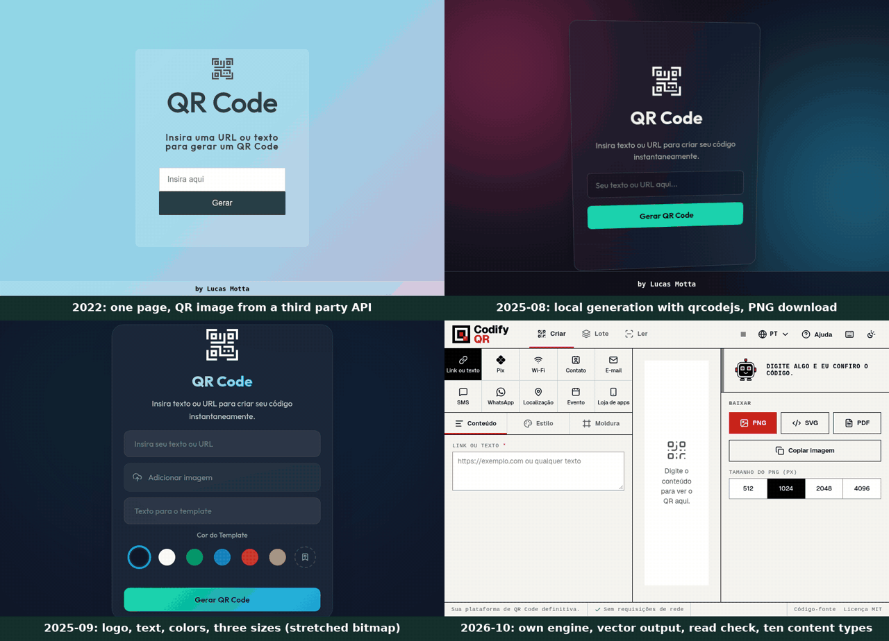

# CodifyQR

CodifyQR é um gerador de QR Code gratuito e de código aberto que roda inteiro no navegador: sem conta, sem rastreio e sem nenhuma requisição de rede depois que a página carrega.

[Abrir o app](https://lucaswotta.github.io/codifyqr/) · [English](README.md) · [Español](README.es.md)


## O que faz

- **Dez tipos de conteúdo**: link ou texto, Pix (BR Code com CRC16), Wi-Fi, contato (vCard), e-mail, SMS, WhatsApp, localização, evento de calendário, link de loja de apps.
- **Estilos**: cinco formas de módulo, três molduras e três centros de olho, degradê, fundo transparente, borda ajustável e logo que substitui os módulos sob ele em vez de cobri-los. Molduras para adesivo, cartão de visita, cartão de mesa, placa de Wi-Fi e cobrança Pix.
- **Conferência de leitura**: decodifica o código pronto em três qualidades simuladas de câmera (3, 5 e 10 pixels por módulo, com desfoque), diz por que falha (contraste, cores invertidas, tamanho do logo, borda, densidade, forma) e oferece a correção com um clique.
- **Exportação**: PNG de 512 a 4096 px, SVG, PDF com o tamanho de impressão em centímetros e aviso quando os módulos ficam abaixo de 0,4 mm, copiar para a área de transferência, compartilhar.
- **Lote**: cole linhas ou importe um CSV (conteúdo e nome de arquivo opcional), até 500 linhas, baixado como ZIP de arquivos PNG ou SVG.
- **Leitor**: lê pela câmera ou por imagem e mostra o conteúdo. Nunca abre um link sozinho e avisa sobre encurtadores, domínios com caracteres parecidos, endereços IP, `http`, credenciais embutidas e conteúdo `javascript:` ou `data:`.
- **Ajuda e atalhos**: um guia embutido para quem usa pela primeira vez e atalhos de teclado para tipos, painéis, exportações, tema e idioma. Os atalhos de uma tecla podem ser desligados.
- **PWA offline** com temas claro e escuro em inglês, português (Brasil) e espanhol.

| Estilos | Molduras |
| --- | --- |
|  |  |


## Por que as imagens saem nítidas

O codificador em `src/qr/encoder.ts` gera a matriz de módulos e `src/qr/svg.ts` a desenha como caminhos vetoriais. PNG e PDF são rasterizados desse vetor no tamanho escolhido. A versão 1.x desenhava um bitmap de 500 px e o esticava, o que borrava os módulos em 1024 e 2048 px.

O codificador segue o algoritmo do [gerador de QR Code do Project Nayuki](https://www.nayuki.io/page/qr-code-generator-library) (MIT), reescrito em TypeScript. Os testes unitários decodificam de volta com o jsQR todas as versões (1 a 40) e todos os níveis de correção. A versão 23 é conferida pela estrutura, porque o jsQR lista uma posição errada para o padrão de alinhamento dela. Um script à parte (`scripts/crosscheck`) exporta 48 PNGs estilizados e os lê com o zxing-cpp: 48 de 48 foram lidos.

## Privacidade

- A página publicada define `Content-Security-Policy` com `connect-src 'none'` e `script-src 'self'`. Ela não consegue enviar dados a lugar nenhum, e um teste ponta a ponta falha se uma requisição sair da origem.
- Sem analytics, sem cookies, sem fontes ou scripts externos.
- Estilos salvos, links de estilo (`#s=...`) e arquivos de estilo exportados guardam só o visual. Chaves Pix, senhas de Wi-Fi e outros conteúdos nunca são guardados, colocados em URL nem escritos em log.
- Os nomes dos arquivos exportados não contêm o conteúdo.

## Pix

O construtor de Pix escreve um BR Code estático (`br.gov.bcb.pix`, reutilizável) e valida a chave antes de desenhar: dígitos verificadores de CPF e CNPJ (inclusive o CNPJ alfanumérico), telefone, e-mail e chave aleatória. Um CPF digitado com pontuação que falha nos dígitos verificadores é recusado, em vez de ser lido como telefone. Nome e cidade saem sem acento, em maiúsculas e cortados em 25 e 15 caracteres, como a especificação exige. O payload termina com o CRC16/CCITT-FALSE, testado contra o exemplo do manual do Banco Central.

## Requisitos e instalação

- Node 22 ou mais novo, pnpm 12 (`corepack enable`), Google Chrome para os testes ponta a ponta.

```sh
pnpm install
pnpm dev                 # http://localhost:5173/codifyqr/
pnpm build               # checagem de tipos e build de produção em dist/
pnpm preview             # serve dist/ em http://localhost:4173/codifyqr/
pnpm lint && pnpm typecheck && pnpm test
pnpm test:e2e            # precisa de um build antes
```

`CODIFYQR_BASE` muda o caminho base do build (padrão `/codifyqr/`). Use `CODIFYQR_BASE=/` para servir da raiz de um domínio.

## Verificações de qualidade

A CI (`.github/workflows/ci.yml`) roda a cada push:

- Lint e formatação com Biome, TypeScript em modo estrito.
- Testes unitários (Vitest) e ponta a ponta (Playwright, Chrome), incluindo imagens exportadas decodificadas de volta ao texto, uso offline, política de segurança de conteúdo, traduções e checagens de acessibilidade com axe (WCAG 2.2 AA, sem violações sérias).
- Orçamento do primeiro carregamento: 80 KB gzip, fonte incluída (`scripts/size-budget.mjs`; hoje cerca de 68 KB).
- Metas do Lighthouse: desempenho de pelo menos 95, acessibilidade, boas práticas e SEO em 100 (`scripts/lighthouse-check.mjs`).

## Limitações

- Os códigos são sempre estáticos. Não há serviço de redirecionamento, então um código não pode ser editado depois de impresso e nada conta leituras. É proposital: um código impresso nunca depende de servidor nem de assinatura.
- O PDF embute uma imagem de alta resolução (até 600 dpi, menos em páginas grandes). Para arquivos de impressão totalmente vetoriais, use o SVG.
- A conferência de leitura simula leitores; não prova que todo celular vai ler o código. Ela decodifica com o `BarcodeDetector` da plataforma quando o navegador tem e com o jsQR nos demais casos.
- O construtor de Pix cria só códigos estáticos. Cobranças dinâmicas exigem um prestador de serviço de pagamento.
- O texto é limitado a 2000 caracteres e ao que cabe em um código versão 40 com a correção de erro escolhida.
- A ferramenta de lote processa até 500 linhas na thread principal, em passos pequenos.
- O Safari anterior à 16.4 não tem `CompressionStream`; o PDF nele sai com resolução menor e sem compressão.

## Histórico do projeto

| Período | Estado |
| --- | --- |
| 2022 | Uma página que chamava uma API de terceiros para a imagem do QR. |
| 2025-08 | Geração local com `qrcodejs` e download em PNG. |
| 2025-09 | Logo, texto, cores e três tamanhos de exportação; saída com bitmap esticado. |
| 2026-10 | Reescrita: codificador próprio, renderização vetorial, conferência de leitura, dez tipos de conteúdo, PWA. Veja o [CHANGELOG.md](CHANGELOG.md). |



Cada fase foi gravada do próprio commit (`004d276`, `c46d0a5`, `cd6e7c9` e o build atual): [2022](docs/media/evolution/2022-10.gif), [2025-08](docs/media/evolution/2025-08.gif), [2025-09](docs/media/evolution/2025-09.gif), [2026-10](docs/media/evolution/2026-10.gif). O `scripts/media/evolution.mjs` as regenera.

## Contribuir, segurança, licença

Veja o [CONTRIBUTING.md](CONTRIBUTING.md) (inclusive como adicionar um idioma) e o [SECURITY.md](SECURITY.md). Licença MIT, veja [LICENSE](LICENSE) e [NOTICE](NOTICE).
